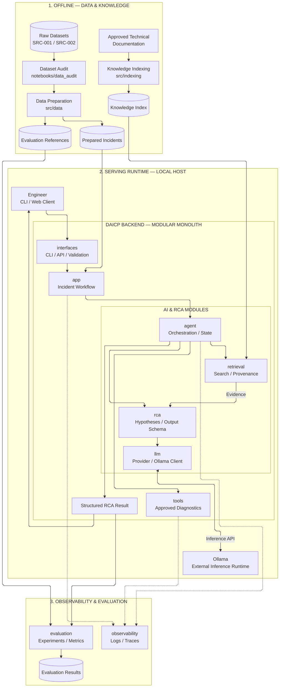
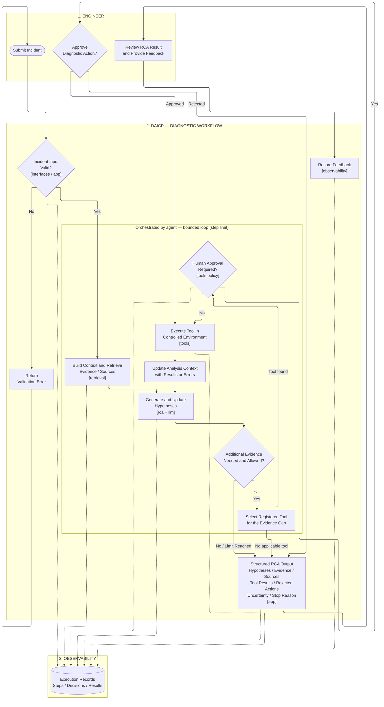

# Architecture Overview

## 1. Purpose

This document defines the high-level architecture of the Distributed Agentic AI Compute Platform (DAICP) MVP, including its architectural style, main components, responsibilities, interactions, and execution boundaries.

The architecture supports AI-assisted telecommunications troubleshooting and Root Cause Analysis (RCA), emphasizing evidence traceability, modularity, controlled tool execution, and reproducibility.

## 2. Architectural Style and Scope

### 2.1 Architectural Style

The DAICP MVP adopts a **Modular Monolith Architecture**.

The system separates its functional responsibilities into independent Python modules within a single backend application. Modules interact through defined internal interfaces, avoiding unnecessary distributed communication.

Data preparation, knowledge indexing, and experimental evaluation are separate workflows that support the runtime application.

LLM inference is accessed through a provider interface, allowing the inference runtime to operate independently of the backend.

This approach enables incremental development and future extraction of components into independent services when technically justified.

### 2.2 MVP Scope

The system supports the following capabilities:

1. Receive an incident and its available technical context.
2. Retrieve relevant technical information from approved knowledge sources.
3. Provide retrieved evidence to an existing Large Language Model.
4. Generate Root Cause Analysis hypotheses supported by technical evidence.
5. Execute approved diagnostic or information-retrieval tools when necessary.
6. Produce structured troubleshooting results with hypotheses, evidence, source references, tool results, and uncertainty.

The MVP operates in a controlled development and evaluation environment.

Production network integration, autonomous remediation, unrestricted agent execution, and enterprise-scale deployment are outside the initial scope.

## 3. High-Level System Architecture

The architecture is organized into three main areas:

- **Offline Data and Knowledge Preparation:** dataset auditing, incident preparation, and knowledge indexing.
- **Serving Runtime:** the modular backend, agent orchestration, retrieval, RCA generation, and controlled tool execution.
- **Observability and Evaluation:** execution traceability, experimental evaluation, and result analysis.

### 3.1 Modular Architecture Diagram

**Diagram interpretation:**

- Rectangles represent processing components or logical modules.
- Cylinders represent data artifacts, datasets, or indexes.
- Solid arrows represent data flow or component interactions.
- Dashed arrows represent auxiliary logging and traceability.
- Subgraphs represent logical or execution boundaries, not necessarily independent services.

The backend modules belong to the same application. They do not require individual containers or network APIs.

The diagram represents the intended MVP architecture. Some components already have initial implementations, while others remain to be developed.

### 3.2 Local Deployment Model

The initial deployment follows a local-first approach:

- The DAICP backend runs as a Python application.
- The LLM inference runtime operates independently and is accessed through an API.
- Prepared incident data and the knowledge index are stored locally.
- Offline preparation and evaluation workflows can execute independently of the serving application.
- Containerization may be introduced without changing the logical module boundaries.

The deployment architecture does not require microservices or mandatory cloud infrastructure.

## 4. Runtime Analysis Workflow

This section describes the execution sequence followed when an engineer submits an incident for analysis.

### 4.1 Diagnostic Workflow Diagram

### 4.2 Workflow Rules

**Evidence Retrieval**

The system retrieves relevant technical information and preserves the references required to identify its original sources.

**RCA Generation**

The LLM generates hypotheses using the available incident context and retrieved evidence. Generated hypotheses must remain distinguishable from source-derived facts.

**Controlled Tool Execution**

The agent may request additional diagnostic information through approved tools.

Tool execution is subject to:

- explicit tool authorization;
- execution and iteration limits;
- human approval when required by the action policy;
- controlled execution boundaries;
- recording of relevant inputs, outputs, and errors.

**Result Generation**

The system produces a structured troubleshooting result containing hypotheses, supporting evidence, source references, tool execution results when applicable, and uncertainty or limitations.

**Traceability**

Relevant actions and decisions are recorded to support auditability and reproducibility.

## 5. Main Components and Responsibilities

| Component | Responsibility |
|---|---|
| **Interfaces** | Receives incident requests, validates input, and exposes CLI or API interactions. |
| **Application** | Coordinates the incident analysis use case and application-level workflow. |
| **Data Preparation** | Audits, validates, and prepares incident data from approved sources. |
| **Knowledge Indexing** | Processes technical documentation into retrieval-ready knowledge artifacts. |
| **Retrieval** | Finds relevant technical information and preserves source references. |
| **LLM Integration** | Provides a replaceable interface to pretrained language models and inference runtimes. |
| **RCA** | Generates and structures evidence-supported Root Cause Analysis hypotheses. |
| **Agent** | Coordinates analysis, manages execution state, and requests tools when additional evidence is required. |
| **Tools** | Provides authorized diagnostic and information-retrieval operations. |
| **Observability** | Records execution events, actions, errors, and traceability information. |
| **Evaluation** | Evaluates system outputs against available, validated references and experimental criteria. |

Each module shall maintain a clearly defined responsibility.

Module boundaries are logical boundaries within the monolithic backend; they do not imply separate deployment units.

## 6. Component Interaction

The backend follows a modular interaction model:

1. The **Interfaces** module receives and validates a request.
2. The **Application** module initiates the incident analysis workflow.
3. The **Agent** coordinates retrieval, RCA generation, and approved tool execution.
4. The **Retrieval** module accesses the prepared knowledge index.
5. The **RCA** module uses the **LLM Integration** module to generate evidence-supported hypotheses.
6. The **Tools** module performs authorized diagnostic operations when required.
7. The resulting analysis is returned as a structured troubleshooting output.

The modules communicate through defined internal interfaces.

LLM inference remains isolated behind a provider abstraction so that a specific inference runtime is not required by other modules.

Observability functions operate across the workflow to preserve execution traceability.

## 7. Data and Knowledge Boundaries

The architecture distinguishes between the following data categories:

| Data Category | Purpose |
|---|---|
| **Raw Data** | Original telecommunications datasets preserved without modification. |
| **Processed Data** | Prepared incidents and technical records used during development or analysis. |
| **Technical Knowledge** | Approved telecommunications documentation prepared for retrieval. |
| **Evaluation References** | Validated labels or reference information used to assess system results. |
| **Runtime Context** | Incident information, retrieved evidence, and tool outputs associated with an active analysis. |
| **Generated Outputs** | Structured RCA results and associated execution records. |

Raw datasets shall remain separate from processed artifacts.

Source identifiers and relevant provenance metadata shall be preserved throughout data preparation, retrieval, and analysis.

Evaluation references shall not be exposed to the analysis process in ways that could introduce label leakage or compromise experimental validity.

## 8. Execution Constraints

The MVP architecture shall:

- operate within available local computing resources;
- use existing pretrained Large Language Models;
- support modular replacement of major AI and retrieval components;
- avoid mandatory cloud dependencies;
- restrict agent actions to approved tools and controlled execution environments;
- preserve execution information required for reproducibility and traceability.

The architecture may use local inference services or additional infrastructure components without changing the responsibilities of the core modules.

## 9. Architectural Boundaries

The following capabilities are outside the initial MVP scope:

- direct integration with production telecommunications infrastructure;
- autonomous production remediation;
- unrestricted command execution;
- enterprise-scale multi-user deployment;
- mandatory distributed infrastructure;
- mandatory cloud deployment.

Future architectural extensions may introduce independently deployable services when required by scaling, hardware distribution, isolation, or operational constraints.

Such extensions should preserve the core modular responsibilities defined in this document.